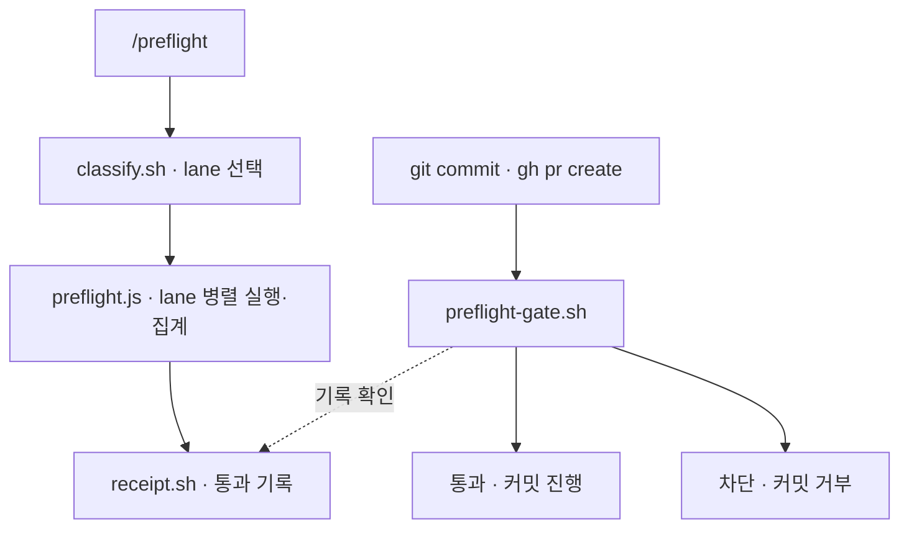
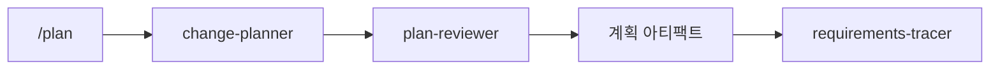

# harness-engine

Claude Code 용 **커밋·PR 품질 게이트 하네스**. 커밋과 PR 앞에서 검사(lane)를 고르고, 병렬로 돌리고, 결과와
**절차가 밟혔는지**를 기록한 뒤, `git commit`·`gh pr create` 직전에 훅이 그 기록을 다시 확인한다.

```
classify.sh ──▶ preflight.js ──▶ 집계 ──▶ receipt.sh ──▶ PreToolUse 훅
 결정론          LLM · 병렬       결정론     결정론          결정론
 lane 선택       lane 실행        판정 산출  절차 검증       커밋 직전 재검증
```

**LLM 은 가운데 한 칸에만 있다.** 무엇을 검사할지도, 결과를 어떻게 합칠지도, 통과 여부도 코드가 정한다.
그리고 결과만이 아니라 절차를 검증한다 — 선택된 lane 이 전부 기록됐는가, 전사에 실제 실행이 있는가,
순차 lane 의 순서가 맞았는가, 승인 흔적 없이 통과로 승격된 lane 이 없는가.

## 세 층 — 엔진 · 카테고리 · 프로필

| 층 | 담는 것 | 어디에 |
|---|---|---|
| **엔진** | 분류·실행/집계·기록/검증·훅·계획 사이클·프로필 생성기 | 이 레포 |
| **카테고리** | 레포 성격별 규칙 — 소속 판정(`match`), 관례 검사기, QA 엔드포인트, vault 연동, 자체 회귀 스위트, 절차 요구 | 엔진(`skills/preflight/categories/`) + **오버레이**(`categories/`) |
| **프로필** | 레포 하나의 카테고리 고정과 승인된 조정(force-lane) | `profiles/<owner>/<repo>.json` (오버레이가 있으면 오버레이) |

엔진이 싣는 카테고리는 둘이다.

- `shell-tool` — 이 엔진 레포 자신(스냅숏에 `skills/preflight/meta-test.sh` 와 `hooks/preflight-gate.sh`). 자체 회귀 스위트를 돌린다.
- `generic` — **기본 카테고리.** 어느 카테고리에도 신호가 없는 레포가 여기 속한다(선언의 `fallback`). 규칙이 없어 엔진 공통 규칙만 걸린다.

조직 전용 규칙(사내 관례 검사기, 배포 엔드포인트 해석, 문서 vault 연동 등)은 **오버레이 레포**에 카테고리로 둔다.
엔진은 카테고리 이름을 모르고, 카테고리는 `rules.py` 의 함수로만 엔진에 끼어든다(`classify.sh` 의 "카테고리" 절이 계약).
둘 이상의 카테고리에 걸리거나 루트 사이 이름이 겹치면 분류하지 않는다(exit 3) — 어느 쪽 규칙인지 모르는 채로 고르지 않는다.

## 설치

```bash
git clone https://github.com/SimSimEEE/harness-engine.git ~/dev/harness-engine
~/dev/harness-engine/install.sh --link                        # 엔진만
~/dev/harness-engine/install.sh --link --overlay <오버레이>    # 조직 오버레이와 함께
```

- `--link`: `~/.claude/{agents,skills,hooks}` 를 실제 디렉터리로 두고 항목마다 체크아웃으로 심링크한다. 엔진을 먼저 걸고
  오버레이의 같은 이름 항목이 덮는다(조직판 lane 에이전트로 바꿀 때 쓴다). 치우는 기존 항목은 `~/.claude/backups/harness-engine-<ts>/` 로 옮긴다.
- `--copy`: 클라우드 세션 등 일회성 환경. 기존 디렉터리에 합쳐 복사하고, 오버레이의 `categories`·`profiles` 는 `~/.claude/harness-overlay` 로 복사한다.
- `~/.claude/settings.json` 의 `hooks` 에 `settings.hooks.json`(오버레이에 있으면 그것도)을 병합한다.
- 설치본 `skills/preflight/config.json`(머신 로컬, 커밋하지 않음)을 `config.example.json` 에서 만들고 `overlayDir` 를 적는다.

### 오버레이 레포의 모양

```
<오버레이>/
  categories/categories.json      {"categories": ["<이름>", …]}
  categories/<이름>/rules.py       match(ctx) 와 선택 규칙들 · procedures.json · (선택) meta-test.sh
  profiles/<owner>/<repo>.json     프로필
  agents/*.md · skills/<이름>/ · hooks/*   엔진 것 위에 얹을 항목(같은 이름이면 덮는다)
  settings.hooks.json              오버레이 훅 등록(선택)
  meta-test.d/*.sh                 엔진 meta-test 에 덧붙일 스위트(선택)
```

## 쓰기

- `/preflight` — 커밋·PR 전 게이트(`skills/preflight/SKILL.md`). 훅이 기록 없는 `git commit`·`gh pr create` 를 막는다.
- `/plan` — 작업 전에 약속(claim)을 계획으로 만들고 리뷰·승인을 받아 브랜치에 결속한다(`skills/plan/SKILL.md`).
- `/harness-profile` — 처음 보는 레포에 프로필을 만든다: 현황 점검 → 이력 실측 → 규칙 후보 4축 표 → 사용자가 승인한 것만 기록.
- `skills/preflight/category.sh <레포>` — 레포의 카테고리·근거 신호·절차 요구 조회(읽기 전용).
- `eval/trigger.sh` — 스킬 description 이 불러야 할 요청에서 불리는지 잰다. 케이스 파일은 `TRIGGER_CASES_DIR`(기본 `eval/triggers/`).

## 검증

```bash
skills/preflight/meta-test-isolated.sh                      # 엔진만
skills/preflight/meta-test-isolated.sh --overlay <오버레이>   # 오버레이를 얹어서
```

임시 HOME 에 이 체크아웃(과 오버레이)을 설치본처럼 얹고 회귀 스위트를 돈다. 실제 `~/.claude` 는 건드리지 않는다.
대부분의 단언은 실제로 일어났거나 일어날 뻔한 일이고, 검사기를 실행해 결과를 본다.

설계 전제·신뢰 경계·알려진 한계는 [`docs/design.md`](docs/design.md), 결정의 경위는 [`skills/preflight/DECISIONS.md`](skills/preflight/DECISIONS.md) 에 있다.

## 지금 하네스

아래는 `make-harness-view.sh` 가 레포에서 읽어 생성한다 — 손으로 고치지 마라.

lane 이 **언제** 도는지는 생성하지 않는다(그 조건은 `classify.sh` 안의 분기이고
소스를 파싱하면 조용히 어긋난다). 조건 설명은 위의 산문과 `docs/design.md` 가 맡는다.

<!-- harness:begin -->

<!-- make-harness-view.sh 가 생성한다. 손으로 고치지 마라. -->

### 강제 경로



### 계획이 닫히는 고리



### lane 10개

이번 분류에서 `classify.sh` 가 보고한 lane 이다 (선택 + 미선택).

| lane | 모델 | 하는 일 |
|---|---|---|
| `code-reviewer` | opus | 코드 변경에 대한 시니어 개발자 롤 컨벤션·품질 리뷰 |
| `crossrepo-impact` | opus | 공용 타입 패키지·공용 라이브러리 패키지 변경이나 공유 의존성 버전 변경이 로컬의 형제… |
| `pr-quality` | haiku | 브랜치명·커밋 메시지·PR 제목/본문 포맷과 base 브랜치를 검사한다 |
| `qa-reviewer` | opus | qa-runner 가 수행한 QA 결과를 시니어 관점에서 심사한다 |
| `qa-runner` | sonnet | 배포된 개발(dev) 환경에 실제 요청을 보내 기능을 검증하는 QA 실행자 |
| `requirements-tracer` | opus | change-planner 가 만든 claim 들이 실제 구현·테스트… |
| `secret-scanner` | sonnet | 스테이징된 변경에서 시크릿·자격증명·개인 데이터 유출을 탐지한다 |
| `test-runner` | sonnet | 대상 레포에서 eslint(변경 파일) + tsc --noEmit + jest를 실행하고… |
| `vault-linter` | sonnet | 지식 vault(루트에 VAULT_RULES.md 가 있는 문서 레포)의 .md 변경분이… |
| `vault-sync` | sonnet | 지식 vault 에 GitHub 연결 프로젝트로 등록된 레포가 변경됐을 때… |

에이전트 정의는 있으나 `classify.sh` 의 lane 집합에 없는 것 4개: `change-planner`, `claim-remeasurer`, `implementer`, `plan-reviewer`. 무엇이 이들을 부르는지는 각 정의가 적는다 — 여기서는 유도할 수 없다.

### 훅

| 이벤트 | matcher | 스크립트 | timeout |
|---|---|---|---|
| PreToolUse | `Bash` | `preflight-gate.sh` | 15s |
| PostToolUse | `Edit\|Write\|MultiEdit\|NotebookEdit\|Bash` | `edit-observe.sh` | 5s |
| UserPromptSubmit | `*` | `category-context.sh` | 5s |

<sub>lane 집합 출처: `classify.sh` 의 분류 출력</sub>

<!-- harness:end -->

## 라이선스

[Apache License 2.0](LICENSE)
